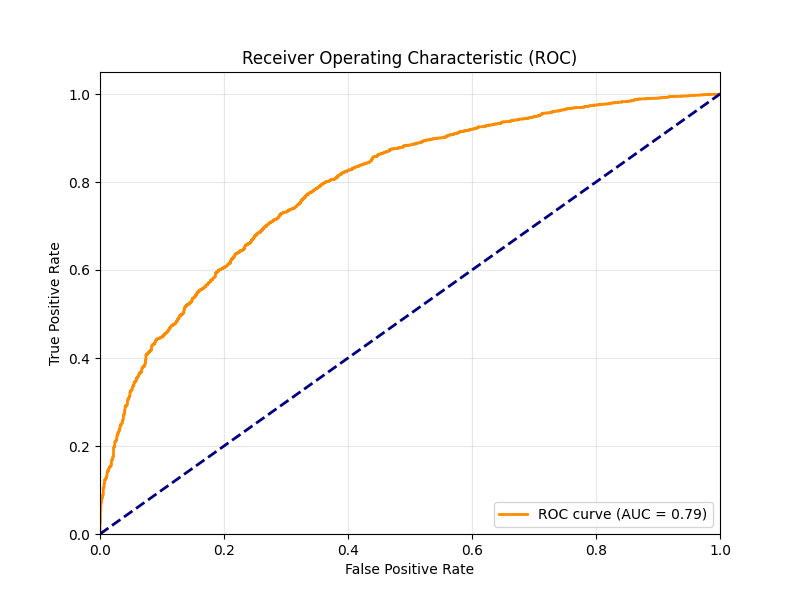
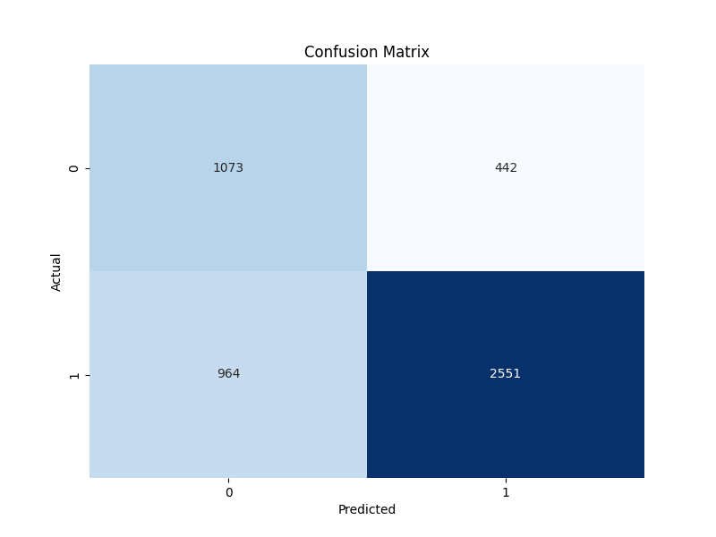
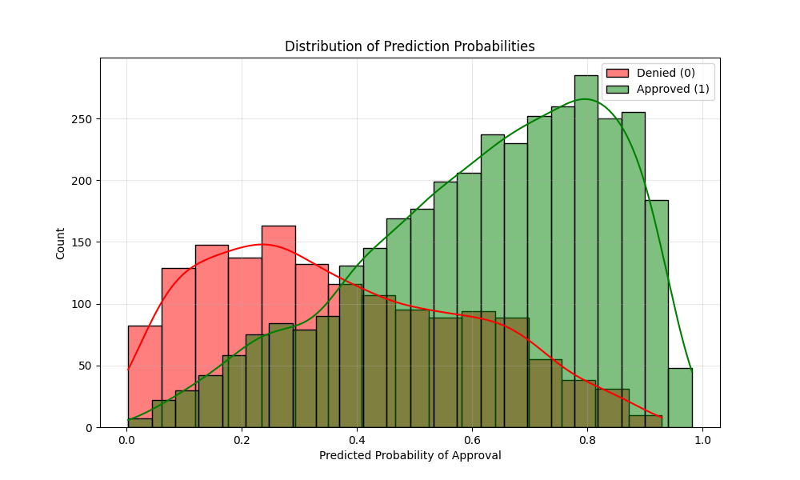

# Credit Card Approval Detection System

A robust, production-ready machine learning system for credit card approval prediction that addresses common shortcomings in off-the-shelf solutions.

## 🎯 Key Features

### 1. **Robust Class Imbalance Handling**
- Advanced resampling techniques (SMOTE, SMOTE-ENN, ADASYN) integrated within cross-validation
- Balanced class weights and ensemble methods
- Prevents biased predictions toward majority class

### 2. **Anti-Leakage Protocols**
- Temporal data splitting to mirror production scenarios
- Feature vetting to prevent target leakage
- Strict train/test separation

### 3. **Advanced Feature Engineering**
- Automated feature selection with L1 regularization
- Domain-specific ratio features (debt-to-income, credit utilization)
- Interaction terms and cross-feature creation

### 4. **Bayesian Hyperparameter Optimization**
- Optuna-based optimization with TPE sampler
- Explores high-dimensional hyperparameter space
- Optimizes preprocessing and model parameters jointly

### 5. **Model Interpretability**
- SHAP (SHapley Additive exPlanations) for local and global explanations
- Feature importance analysis
- Transparent decision-making process

### 6. **Production-Ready API**
- Flask REST API for real-time predictions
- Request monitoring and statistics
- Data drift detection hooks
- Health check endpoints

### 7. **Continuous Monitoring**
- Request logging and statistics
- Performance tracking
- Drift detection infrastructure (ready for implementation)

## 📁 Project Structure

```
Credit card Approval Detection/
├── data/
│   └── credit_card_applications.csv    # Training data
├── models/
│   └── credit_card_approval_model.pkl  # Trained model
├── src/
│   ├── train_model.py                  # Main training script
│   ├── api.py                          # Flask API server
│   └── generate_sample_data.py         # Sample data generator
├── requirements.txt                    # Python dependencies
└── README.md                          # This file
```

## 🚀 Quick Start

### 1. Installation

```bash
# Create virtual environment (recommended)
python -m venv venv
source venv/bin/activate  # On Windows: venv\Scripts\activate

# Install dependencies
pip install -r requirements.txt
```

### 2. Generate Sample Data

If you don't have your own dataset, generate sample data:

```bash
python src/generate_sample_data.py
```

This creates `data/credit_card_applications.csv` with 10,000 synthetic samples.

### 3. Train the Model

```bash
python src/train_model.py
```

This will:
- Load and temporally split the data
- Perform feature engineering
- Run Bayesian hyperparameter optimization (50 trials)
- Train the final model with best parameters
- Generate SHAP explanations
- Save the model to `models/credit_card_approval_model.pkl`

**Expected runtime:** 10-30 minutes depending on your hardware and data size.

### 4. Start the API Server

```bash
python src/api.py
```

The API will start on `http://0.0.0.0:5000`

### 5. Test the API

```bash
# Health check
curl http://localhost:5000/health

# Make a prediction
curl -X POST http://localhost:5000/predict \
  -H "Content-Type: application/json" \
  -d '{
    "age": 35,
    "income": 75000,
    "debt": 15000,
    "credit_score": 720,
    "years_employed": 8,
    "credit_used": 5000,
    "credit_limit": 20000,
    "num_credit_cards": 2,
    "num_loans": 1,
    "employment_status": "employed",
    "education": "bachelor",
    "marital_status": "married",
    "residence_type": "own"
  }'

# Get statistics
curl http://localhost:5000/stats

# Get model info
curl http://localhost:5000/model_info
```

## 📊 Model Details

### Features

The model expects the following features:

**Numeric:**
- `age`: Applicant age (18-80)
- `income`: Annual income
- `debt`: Total debt
- `credit_score`: Credit score (300-850)
- `years_employed`: Years of employment
- `credit_used`: Current credit used
- `credit_limit`: Total credit limit
- `num_credit_cards`: Number of credit cards
- `num_loans`: Number of active loans

**Categorical:**
- `employment_status`: employed, self-employed, unemployed, retired
- `education`: high_school, bachelor, master, phd
- `marital_status`: single, married, divorced
- `residence_type`: own, rent, other

**Engineered Features:**
- `debt_to_income`: debt / income ratio
- `credit_utilization`: credit_used / credit_limit
- `income_per_age`: income / age
- `employment_ratio`: years_employed / age

### Model Architecture

- **Base Classifier:** Logistic Regression with L1/L2/ElasticNet regularization
- **Resampling:** SMOTE, SMOTE-ENN, or ADASYN (optimized)
- **Preprocessing:** Median imputation, standard scaling, one-hot encoding
- **Optimization:** Bayesian optimization with Optuna (TPE sampler)
- **Evaluation:** 5-fold stratified cross-validation with ROC-AUC metric

## 🔧 Configuration

### Training Parameters

Edit `src/train_model.py` to adjust:

- `TRAIN_CUTOFF`: Temporal split date (default: 2023-01-01)
- `n_trials`: Number of Optuna optimization trials (default: 50)
- `n_splits`: Cross-validation folds (default: 5)

### API Configuration

Edit `src/api.py` to adjust:

- `PORT`: API port (default: 5000, can be set via `PORT` environment variable)
- `HOST`: API host (default: 0.0.0.0, can be set via `HOST` environment variable)

## 📈 Monitoring & Production

### Request Monitoring

The API automatically logs all prediction requests with:
- Timestamp
- Input features
- Prediction probability
- Decision (approved/denied)
- Response time

Access statistics via `/stats` endpoint.

### Data Drift Detection

The system includes hooks for drift detection. To implement:

1. Collect reference data distribution during training
2. Implement statistical tests (Kolmogorov-Smirnov, PSI) in `detect_data_drift()`
3. Set up alerts when drift is detected

### Model Retraining

Recommended retraining schedule:
- **Monthly:** For stable economic conditions
- **Weekly:** During volatile periods
- **On-demand:** When drift is detected

To retrain:
```bash
python src/train_model.py
```

The new model will overwrite the existing one. In production, implement versioning and A/B testing.

## 🧪 Evaluation Metrics

The model reports:
- **Classification Report:** Precision, Recall, F1-score per class
- **Confusion Matrix:** True/False Positives/Negatives
- **ROC-AUC:** Area under ROC curve (primary optimization metric)

## 🔒 Privacy & Security

### Current Implementation
- No data persistence (requests logged in memory only)
- HTTPS recommended for production
- Input validation and error handling

### Production Recommendations
- Implement API key authentication
- Use HTTPS/TLS encryption
- Store logs in secure database
- Implement rate limiting
- Add input sanitization
- Consider differential privacy for sensitive data

## 🚧 Advanced Features (Future Work)

### Federated Learning
For multi-institutional scenarios, consider implementing:
- Flower framework for federated learning
- TensorFlow Federated
- Differential privacy layers

### Fairness Constraints
- Monitor disparate impact metrics
- Implement fairness-aware algorithms
- Add demographic parity constraints

### Enhanced Drift Detection
- Kolmogorov-Smirnov tests
- Population Stability Index (PSI)
- Concept drift detection algorithms

## 🐛 Troubleshooting

### Model Not Loading
- Ensure `train_model.py` has been run successfully
- Check that `models/credit_card_approval_model.pkl` exists
- Verify model file is not corrupted

### Prediction Errors
- Check that all required features are provided
- Verify feature types match expected format
- Check API logs for detailed error messages

### Low Performance
- Increase `n_trials` in Optuna optimization
- Add more training data
- Review feature engineering
- Check for data quality issues

## 📝 License

This project is provided as-is for educational and research purposes.

## 🤝 Contributing

Contributions welcome! Areas for improvement:
- Additional feature engineering
- More sophisticated drift detection
- Fairness metrics implementation
- Performance optimizations
- Documentation improvements

## 📚 References

The implementation addresses common issues identified in credit scoring research:
- Class imbalance in credit datasets
- Data leakage prevention
- Feature engineering best practices
- Hyperparameter optimization strategies
- Model interpretability requirements
- Concept drift in production systems
- Privacy-preserving learning approaches

---

## 📊 Model Performance & Findings

### Overview
The model demonstrates solid performance with an **AUC of 0.79**, indicating a strong ability to distinguish between approved and denied applications.

- **Accuracy**: 72%
- **Precision (Approved)**: 0.85 (High reliability when approving)
- **Recall (Denied)**: 0.71 (Good at catching denials, but some missed)

### Visual Analysis

#### 1. ROC Curve
The model maintains a good balance between true positive and false negative rates. The AUC of 0.79 suggests it is far superior to random guessing (0.5).


#### 2. Confusion Matrix
- **Correct Approvals**: 2551
- **Correct Denials**: 1073
- **False Positives (Denied but approved)**: 442
- **False Negatives (Approved but denied)**: 964


#### 3. Probability Distribution
The model shows a clear separation between the distributions of approved vs. denied probabilities, though there is some overlap in the 0.4-0.6 range, which represents "borderline" cases.


### Key Insights
- The model is conservative: it has higher precision for approvals (85%), meaning if it approves someone, they are likely a good candidate.
- It struggles slightly more with correctly identifying all denials (Recall 71%), meaning some risky candidates might slip through or require manual review.
- Recommendation: For production, we might want to adjust the decision threshold depending on business risk appetite (e.g., raise threshold to 0.6 to reduce false positives).

---

---

**Note:** This is a production-ready template. For actual deployment, ensure:
1. Proper security measures (authentication, encryption)
2. Comprehensive testing
3. Monitoring and alerting systems
4. Model versioning and rollback capabilities
5. Compliance with relevant regulations (GDPR, CCPA, etc.)

